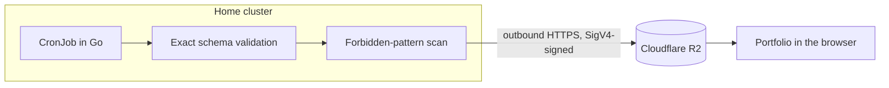

# Homelab Public API

[Leia em português](README.pt-BR.md) · [Case study](https://www.renara.dev/en/cases/homelab-api)

Publishes a curated snapshot of a home Kubernetes cluster so a portfolio can
show real, live data without giving anyone a path into the cluster. A producer
runs inside the cluster, computes aggregate indicators only, and uploads a
single JSON file to a Cloudflare R2 bucket.

The project opens no ports, creates no tunnels, and never exposes the
Kubernetes API. Network traffic is outbound only:



## Highlights

- **Outbound only.** Nothing on the internet can reach the cluster; the job
  pushes a file and exits.
- **Least privilege by inference.** Workload counts are inferred from Pod
  owners instead of reading Deployments, StatefulSets, DaemonSets, or Nodes, so
  the RBAC role stays as narrow as possible.
- **Two gates before every upload.** A closed schema check and a scan for
  private addresses, internal names, and software versions. Any failure aborts
  the job and keeps the last good snapshot online.
- **Zero dependencies.** Go standard library only, including a hand-written
  AWS SigV4 signer for R2. The image is distroless and runs as non-root.
- **CI on GitHub-hosted runners** with actions pinned by SHA: content scan,
  `gofmt`, `go vet`, tests, kustomize render, and image build.

## Published data

The document follows a closed contract:

```json
{
  "schemaVersion": 2,
  "generatedAt": "2026-09-20T14:00:00Z",
  "validUntil": "2026-09-20T17:00:00Z",
  "status": "healthy",
  "gitops": {
    "applications": 15,
    "synced": 15,
    "outOfSync": 0,
    "healthy": 15,
    "degraded": 0,
    "autoSyncEnabled": 15,
    "lastSyncAt": "2026-09-20T13:56:00Z"
  },
  "scale": {
    "namespaces": 14,
    "nodesObserved": 1,
    "workloads": 30,
    "workloadsByKind": {
      "deployments": 20,
      "statefulSets": 4,
      "daemonSets": 3,
      "other": 3
    },
    "podsRunning": 33,
    "pods": {
      "total": 34,
      "running": 33,
      "ready": 33,
      "pending": 0,
      "succeeded": 1,
      "failed": 0
    }
  },
  "tls": {
    "certificates": 2,
    "ready": 2,
    "notReady": 0,
    "expiringWithin30Days": 0,
    "daysToNextRenewal": 294
  },
  "services": ["ArgoCD", "Traefik", "cert-manager", "Infisical"]
}
```

Names discovered in the cluster are never serialized. The `services` list is
fixed in code. Contract v2 is additive: `podsRunning` and `services` keep the
first version's shape. `validUntil` makes the three-hour staleness window
explicit, and `status` only summarizes GitOps and TLS health.

"Workloads" and their breakdown by kind are inferred from Pod controllers.
`nodesObserved` counts distinct node names seen on active Pods, but no name is
ever published. These inferences avoid granting extra read access to Nodes,
Deployments, StatefulSets, or DaemonSets.

Before upload, the whole document goes through two gates:

1. exact validation of fields, types, relationships between counters, and the
   services list;
2. a search for forbidden patterns, including private addresses, internal
   names, and software versions.

Any failure ends the Job before sending and keeps the last valid snapshot in the
bucket.

## Layout

```text
cmd/snapshot/           producer entry point
internal/               Kubernetes client, sanitizer, and R2 client
k8s/base/               minimal RBAC, CronJob, and Infisical integration
docs/decisions/         security decisions and boundaries
tests/                  automated contract and invariants
```

## Local validation

The producer is written in Go and uses only the standard library:

```bash
make fmt
make lint
make test
kubectl kustomize k8s/base >/tmp/homelab-snapshot.yaml
docker build -t homelab-snapshot:test .
```

The [`.editorconfig`](.editorconfig) standardizes UTF-8, LF, final newline, and
indentation across Go, Makefile, YAML, JSON, Markdown, and shell. For Go,
`gofmt` is the canonical formatter and `go vet` does static analysis; CI checks
both.

## Local API for development

The local server uses fictional data only, generates a fresh timestamp on every
request, and accepts connections from the local machine only:

```bash
make dev
```

Endpoints:

- `http://127.0.0.1:8080/snapshot.json`: the contract the frontend consumes;
- `http://127.0.0.1:8080/healthz`: a simple availability check.

By default, CORS allows `http://localhost:5173`. To use another local origin:

```bash
go run ./cmd/devserver -cors-origin http://localhost:4200
```

This server never touches Kubernetes, Infisical, or Cloudflare R2 and is not
part of the image the CronJob runs.

The CI workflow uses GitHub-hosted runners only. On pushes to `main`, it also
publishes the image to the GitHub Container Registry.

## Deployment

The public manifests are a sanitized base, not something to apply without
review. In a private overlay:

1. replace `replace-with-account-id` and `replace-with-bucket-name` in the
   CronJob;
2. replace the example endpoint, project, environment, and path in the
   `InfisicalSecret`;
3. create `infisical-operator-credentials` in the `portfolio` namespace through
   the operator's private bootstrap process;
4. make `R2_ACCESS_KEY_ID` and `R2_SECRET_ACCESS_KEY` available at the
   configured Infisical path;
5. make the GHCR package public or configure an `imagePullSecret` in the
   overlay;
6. pin the image by digest after the first build;
7. render and review the overlay before adding it to GitOps.

The operator credentials Secret must live in the same namespace as the
`InfisicalSecret`. No credential value should ever enter this repository.

R2 setup and the publishing checklist are in
[docs/cloudflare.md](docs/cloudflare.md). The security decisions are in
[docs/decisions/0001-outbound-snapshot.md](docs/decisions/0001-outbound-snapshot.md)
and
[docs/decisions/0002-curation-and-least-privilege.md](docs/decisions/0002-curation-and-least-privilege.md).

## Consumption

The frontend fetches `https://api.renara.dev/snapshot.json`. It should flag the
data as stale once the current time passes `validUntil`. First-version clients
can still compute three hours from `generatedAt`. That flag is presentation
only: all curation already happened before upload.

## License

[MIT](LICENSE)
